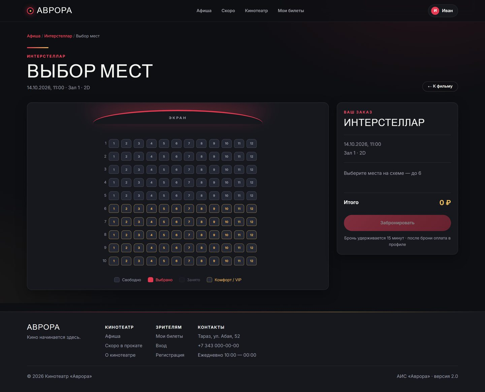
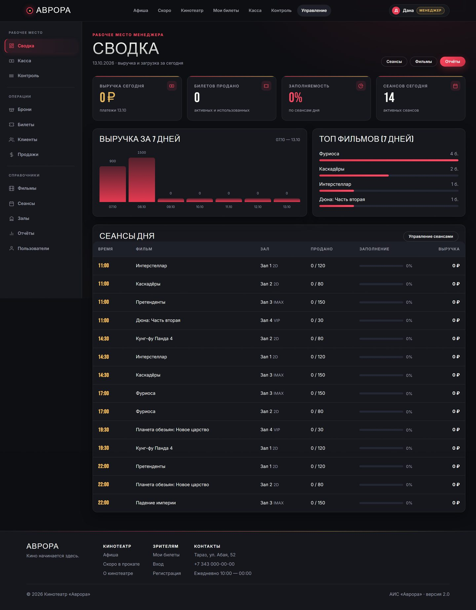

# АИС «Аврора» — веб-система кинотеатра

Django + DRF: афиша, онлайн-бронь мест с QR-билетами, касса, контроль входа, панель менеджера и админка. Премиальный тёмный дизайн без фреймворков (кастомная дизайн-система в `static/css/main.css`).





## Возможности

- **Афиша** — поиск/фильтры по жанру, дате, формату без перезагрузки, расписание по дням, трейлеры, отзывы и оценки, избранное
- **Бронирование** — интерактивная схема зала, атомарное удержание мест («всё или ничего»), таймер 14 минут, оплата одним запросом, билет с QR/штрихкодом
- **Касса** — продажа, подтверждение оплаты, возврат до начала сеанса
- **Контроль** — сканирование/ввод штрихкода, защита от повторного входа
- **Менеджер** — дашборд с метриками, отчёты за 30 дней, экспорт CSV, справочники (фильмы, сеансы, залы, пользователи)
- **Кабинет клиента** — брони/билеты/платежи, отмена брони, смена пароля, редактирование профиля
- **Админка Django** — тёмная тема, сводка KPI, журнал аудита
- **Эксплуатация** — `seed_demo`, `expire_bookings`, `ensure_admin`, `/health/`, Swagger `/api/docs/`, страницы 404/500

## Стек

| Слой | Технологии |
|---|---|
| Backend | Python 3.11/3.12, Django 4.2, DRF 3.15, drf-spectacular |
| БД | PostgreSQL (прод) / SQLite (разработка), `dj-database-url` |
| Frontend | Django Templates, vanilla JS, CSS-переменные (Bebas Neue + Inter) |
| Auth | Session + Token, 5 ролей (client/cashier/controller/manager/admin) |
| Прод | Gunicorn, WhiteNoise, Docker (опционально) |

## Роли

| Роль | Доступ |
|---|---|
| Клиент | афиша, бронь, оплата, кабинет, отзывы, избранное |
| Кассир | касса, продажа/возврат, брони/билеты/продажи |
| Контролёр | проверка билетов, сканер |
| Менеджер | всё выше + дашборд, отчёты, справочники, пользователи |
| Администратор | менеджер + Django-админка |

Подробная матрица: [docs/ROLES.md](docs/ROLES.md).

## Быстрый старт

```bash
git clone <repository-url>
cd cinema_project

python -m venv venv
# Linux/macOS: source venv/bin/activate
# Windows:     venv\Scripts\activate

pip install -r requirements.txt
cp .env.example .env          # при необходимости отредактируйте

python manage.py migrate
python manage.py seed_demo    # демо-данные: роли, жанры, фильмы, залы, сеансы
python manage.py runserver    # http://127.0.0.1:8000/
```

### Демо-аккаунты (после `seed_demo`)

| Логин | Пароль | Роль |
|---|---|---|
| `admin` | `admin12345` | администратор |
| `client` | `client12345` | клиент |
| `cashier` | `cashier12345` | кассир |
| `controller` | `controller12345` | контролёр |
| `manager` | `manager12345` | менеджер |

Пароли демо-аккаунтов выводятся командой `seed_demo` — не используйте их в проде.

## Переменные окружения

Все настройки читаются из окружения/`.env` (см. [.env.example](.env.example)):
`DJANGO_SECRET_KEY`, `DEBUG`, `ALLOWED_HOSTS`, `CSRF_TRUSTED_ORIGINS`, `USE_SQLITE` / `DATABASE_URL` / `POSTGRES_*`, `SECURE_SSL_REDIRECT`, `BOOKING_MAX_SEATS`, `BOOKING_HOLD_MINUTES`, `SESSION_BUFFER_MINUTES`, `ADMIN_USERNAME/EMAIL/PASSWORD`.

## Тесты и качество

```bash
python manage.py test cinema                 # 167 тестов
python -m coverage run manage.py test cinema # замер покрытия
python -m coverage report --include='cinema/*'  # текущее покрытие: 90%
```

## Полезные команды

```bash
python manage.py expire_bookings             # отмена просроченных броней (cron)
python manage.py ensure_admin                # автосоздание суперпользователя (deploy)
python manage.py seed_demo                   # идемпотентная демо-наполнение
python manage.py collectstatic               # сбор статики
python manage.py spectacular --file schema.yml  # OpenAPI-схема
```

## Деплой

См. [CHANGELOG.md](CHANGELOG.md) и артефакты в корне: `build.sh`, `Procfile`, `render.yaml`, `Dockerfile`, `docker-compose.yml`, `.python-version`.

Кратко: задайте `DEBUG=False`, `DJANGO_SECRET_KEY`, `ALLOWED_HOSTS`, `CSRF_TRUSTED_ORIGINS`, `DATABASE_URL`/`POSTGRES_*`, `SECURE_SSL_REDIRECT=True`; выполните `./build.sh`; cron: `python manage.py expire_bookings` каждые 5 минут.

**Постеры**: демо-постеры лежат в `media/posters/` и закоммичены. Загрузки из админки пишутся в `media/` — на хостингах с эфемерным диском настройте внешнее хранилище (S3 и т.п.) или монтируйте volume.

## Документация

- [AUDIT.md](AUDIT.md) — аудит кода (этап 0)
- [docs/ER.md](docs/ER.md) — ER-диаграмма
- [docs/ROLES.md](docs/ROLES.md) — матрица ролей
- [docs/API.md](docs/API.md) — API-эндпоинты
- Swagger: `/api/docs/` (после запуска)

## Лицензия

MIT License — см. [LICENSE](LICENSE).
